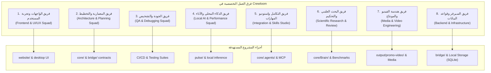

# فهرس وتوزيع المهارات وفرق العمل الهندسية — Skills & Teams Catalog

تاريخ الاعتماد: 28 أكتوبر 2026  
المرجعية: متوافق بالكامل مع مواصفات `AGENTS.md` و `CONSTITUTION.md` ومعايير `SKILL.md` المعتمدة.

---

## 1. نظرة عامة على المهارات المثبتة (Installed High-Value Skills)

تم تثبيت وتفعيل حزم المهارات الأكثر شهرة والأعلى نجوماً على GitHub في مساري المشروع المعتمدين:
- `.agent/skills/`: لاكتشاف المهارات الفوري داخل بيئات Antigravity وClaude Code.
- `.agents/skills/`: المرجع الهيكلي الموحد للحزم والأدوات.
- `.claude/skills/`: مسار الاكتشاف الوحيد في Claude Code؛ يحتوي روابط رمزية (symlinks) إلى `.agent/skills/`. أي مهارة جديدة تُضاف في `.agent/skills/` تحتاج رابطاً هنا أيضاً وإلا لن تظهر لـ Claude Code.
- `grill-me` و `wayfinder` معطّلتان عن الاستدعاء التلقائي (`disable-model-invocation: true`)؛ تُستدعيان بالاسم فقط.

| المهارة | المصدر الأساسي | النجوم/الشهرة | الدور والقيمة الهندسية |
| :--- | :--- | :--- | :--- |
| **`frontend-design`** | `anthropics/skills` | ~180k+ | توجيه بصري متقدم لمنع التصاميم النمطية للذكاء الاصطناعي (Anti-AI-Slop). |
| **`ui-ux-pro-max`** | Local / Multi-model | ~130k+ | أنظمة التصميم، قواعد UX، التايبوغرافي، باليتات الألوان، والتوافق البصري. |
| **`web-design-guidelines`** | `vercel-labs/agent-skills` | ~35k+ | تدقيق واجهات الويب ومعايير الوصول (A11y) والأداء التفاعلي. |
| **`vercel-react-best-practices`** | `vercel-labs/agent-skills` | ~35k+ | قواعد أداء Next.js و React وتحسين حزم الجافاسكربت وتخفيف استهلاك الموارد. |
| **`vercel-composition-patterns`** | `vercel-labs/agent-skills` | ~35k+ | أنماط التركيب النظيف للمكونات وحل معضلة تكاثر الـ Props (Boolean props). |
| **`webapp-testing`** | `anthropics/skills` | ~180k+ | أتمتة واختبار الواجهات محلياً عبر Playwright والتقاط الشاشات وسجلات الـ DOM. |
| **`grill-me` / `grilling`** | `mattpocock/skills` | فائق الشهرة | استجواب المطور ومحاكمة التصميم والقرارات المعمارية قبل الشروع في الكود. |
| **`codebase-design`** | `mattpocock/skills` | فائق الشهرة | تصميم الوحدات العميقة (Deep Modules) وتحديد الفواصل المعمارية وسهولة التنقل. |
| **`wayfinder`** | `mattpocock/skills` | فائق الشهرة | رسم خرائط اتخاذ القرار وتجزئة المهام المعقدة لمهام صغيرة مترابطة. |
| **`yagni-discipline`** | Production Invariant | معيار هندسي | مكافحة التعقيد الزائد ومنع الـ Over-engineering والتجريدات غير المطلوبة. |
| **`tdd`** | `mattpocock/skills` | فائق الشهرة | دورة التنمية الموجهة بالاختبار الصارمة (Red-Green-Refactor) ومنع التراجع. |
| **`diagnosing-bugs`** | `mattpocock/skills` | فائق الشهرة | دورة التحري المنهجي لتشخيص العلل البرمجية وتكرار الخطأ قبل كتابة الحل. |
| **`code-review`** | `mattpocock/skills` | فائق الشهرة | مراجعة الكود عبر وكيلين متوازيين (محور المعايير ومحور مطابقة المتطلبات). |
| **`caveman`** | Open Standard | شائع جداً | اقتصاد صارم للسياق (Token Economy) وإلغاء الثرثرة والتركيز على الكود فقط. |
| **`mcp-builder`** | `anthropics/skills` | ~180k+ | بناء خوادم بروتوكول سياق النماذج (MCP Servers) بجودة قياسية. |
| **`skill-creator`** | `anthropics/skills` | ~180k+ | إنشاء المهارات الجديدة وتعديلها واختبار دقة تفعيلها بالمعايير القياسية. |
| **`remotion-create`** | `remotion-dev/skills` | فائق الشهرة | إنشاء مشاريع وتكوينات الفيديو البرمجية بالكود من الصفر (React/TypeScript). |
| **`remotion-markup`** | `remotion-dev/skills` | فائق الشهرة | هندسة الأنيميشن وحركات الكاميرا والـ Spring physics بدقة 60fps. |
| **`remotion-captions`** | `remotion-dev/skills` | فائق الشهرة | توليد وتحريك النصوص والترجمة كلمة بكلمة المتزامنة مع الصوت لـ Reels/TikTok. |
| **`remotion-render`** | `remotion-dev/skills` | فائق الشهرة | تصدير ورندرة فيديوهات MP4/WebM عبر الـ CLI والسحابة بأقصى توازي (Concurrency). |
| **`remotion-studio`** | `remotion-dev/skills` | فائق الشهرة | استوديو المعاينة التفاعلية والتعديل الحي للفيديو في المتصفح. |
| **`remotion-best-practices`** | `remotion-dev/skills` | فائق الشهرة | موجه المعمارية وضبط جودة الفيديو وحسابات التايم لاين والأداء. |
| **`postgres`** | Ecosystem Standard | فائق الأهمية | تصميم المخططات (Schemas)، استعلامات SQL المثالية، وعمليات الفهرسة والتهجير (Migrations). |
| **`pr`** | `mattpocock/skills` | فائق الشهرة | صياغة وتوثيق طلبات السحب (Pull Requests) الاحترافية وربط الأدلة وسجلات التغيير. |
| **`vercel-react-view-transitions`** | `vercel-labs/agent-skills` | ~35k+ | انتقالات الصفحات والعناصر عبر View Transition API في React و Next.js. |
| **`distributed-systems-architecture`** | Local | معيار هندسي | نمذجة C4 وحدود DDD وأنماط الأنظمة الموزعة المرنة (Outbox، Circuit Breaker، Idempotency). |
| **`crewloom-ai-pulse`** | Local (Crewloom) | خاص بالمشروع | مواصفات محرك القرارات المحلي Pulse وبث `.crw` المشفر والـ sidecar. |
| **`peer-review`** | Local | معيار علمي | صياغة مراجعات تحكيم علمي منظمة ومقيدة بالأدلة. |
| **`scientific-critical-thinking`** | Local | معيار علمي | تقييم جودة الأدلة والتحيزات والعوامل المربكة في الادعاءات العلمية. |
| **`agents-sdk`** | `cloudflare/skills` | Cloudflare | بناء وتصحيح ومراجعة وكلاء Cloudflare Agents SDK (حالة دائمة، WebSockets، أدوات). |
| **`durable-objects`** | `cloudflare/skills` | Cloudflare | حالة متسقة ومنسّقة على الـ edge عبر Durable Objects. |
| **`workers-best-practices`** | `cloudflare/skills` | Cloudflare | أفضل ممارسات كتابة Workers ومراجعتها. |
| **`workers-profiling`** | `cloudflare/skills` | Cloudflare | تحليل أداء Workers وتحديد الاختناقات. |
| **`wrangler`** | `cloudflare/skills` | Cloudflare | الإعداد والنشر عبر Wrangler CLI. |
| **`web-perf`** | `cloudflare/skills` | Cloudflare | تدقيق أداء الويب (Core Web Vitals) لموقع `website/`. |
| **`nextjs-on-cloudflare`** | `cloudflare/skills` | Cloudflare | نشر Next.js على Cloudflare. |
| **`cloudflare-email-service`** | `cloudflare/skills` | Cloudflare | إرسال واستقبال البريد عبر Cloudflare Email. |
| **`agent-platform-eval-flywheel`** | `google/skills` | Google | حلقة تقييم مستمر للوكلاء والنماذج. |
| **`agent-platform-skill-registry`** | `google/skills` | Google | أنماط إدارة سجل المهارات. |
| **`agent-platform-prompt-management`** | `google/skills` | Google | إدارة وإصدار الـ prompts. |
| **`agent-platform-rag-engine-management`** | `google/skills` | Google | إدارة محركات RAG. |
| **`google-cloud-solution-multi-agent-security`** | `google/skills` | Google | أمان أنظمة الوكلاء المتعددين. |
| **`google-cloud-waf-security`** | `google/skills` | Google | ركيزة الأمان في Well-Architected Framework. |
| **`apigee-agent-gateway-governance`** | `google/skills` | Google | حوكمة بوابات الوكلاء (ينفّذ سكربتات؛ راجعها قبل التشغيل). |
| **`retrieving-developer-knowledge`** | `google/skills` | Google | استرجاع وثائق المطورين الحديثة. |
| **`finding-google-skills`** | `google/skills` | Google | اكتشاف مهارات Google المناسبة للمهمة. |
| **`migrate-to-rust`** | `google/skills` | Google | ترحيل الشيفرة إلى Rust (يخدم `src-tauri`). |
| **`doc-coauthoring`** | `anthropics/skills` | Anthropic | تأليف مستندات مشتركة منظمة. |
| **`docx`** | `anthropics/skills` | Anthropic | قراءة وإنشاء وتعديل Word (ترخيص مملوك؛ لا يُنقل لمستودعات عامة). |
| **`pdf`** | `anthropics/skills` | Anthropic | معالجة PDF (ترخيص مملوك؛ لا يُنقل لمستودعات عامة). |
| **`pptx`** | `anthropics/skills` | Anthropic | عروض PowerPoint (ترخيص مملوك؛ لا يُنقل لمستودعات عامة). |
| **`xlsx`** | `anthropics/skills` | Anthropic | جداول Excel (ترخيص مملوك؛ لا يُنقل لمستودعات عامة). |
| **`web-artifacts-builder`** | `anthropics/skills` | Anthropic | بناء artifacts ويب متعددة المكونات. |
| **`council`** | `0xNyk/council-of-high-intelligence` | ~4.7k | مجلس من 18 شخصية فكرية (Socrates, Feynman, Munger, Taleb…) بمداولة مستقلة ثم مناظرة مجهولة الهوية وحكم رئيس المجلس. أدوات الأعضاء مقيّدة بـ Read/Grep/Glob. المحاكاة لأسلوب التفكير وليست اقتباسات. |

---

## 2. توزيع المهارات على فرق العمل التخصصية (Specialized Engineering Squads)

تم توزيع المهارات على **8 فرق هندسية تخصصية** متوافقة مع البنية التحتية لـ Crewloom:

### الفريق الأول: فريق الواجهات وتجربة المستخدم (Frontend & UI/UX Squad)
* **المسؤولية:** تطوير وتدقيق واجهات الويب وتطبيق الديسكتوب، ومنع التصاميم الاصطناعية المبتذلة، وضمان سلاسة وسرعة التفاعل ومطابقة الـ A11y.
* **النطاق البرمجي:** `website/` (Next.js) و `agent/apps/crewloom-desktop/src/` (React + Tailwind).
* **حزمة المهارات المعتمدة:**
  - `frontend-design`: التوجيه البصري الراقي ومحاربة الـ AI Slop.
  - `ui-ux-pro-max`: أنظمة التصميم الشاملة، الألوان، التايبوغرافي، والـ Dark Mode.
  - `web-design-guidelines`: فحص معايير إمكانية الوصول والتنقل بلوحة المفاتيح.
  - `vercel-react-best-practices`: سرعة استجابة المكونات وأداء Next.js.
  - `vercel-composition-patterns`: معمارية المكونات القابلة لإعادة الاستخدام.
  - `crewloom-brand-kit`: اتساق الهوية البصرية للعلامة التجارية.
  - `vercel-react-view-transitions`: انتقالات الصفحات والعناصر بالـ View Transition API.

---

### الفريق الثاني: فريق المعمارية والتخطيط الهندسي (Architecture & Planning Squad)
* **المسؤولية:** تحكيم المتطلبات البرمجية قبل كتابة الكود، التخطيط الهيكلي، وتفكيك المهام لمنع التعقيد الزائد وتجنب الـ Over-engineering.
* **النطاق البرمجي:** `core/Brain/`، `bridge/src/domain/`، و `agent/packages/crewloom/contracts/`.
* **حزمة المهارات المعتمدة:**
  - `grill-me` / `grilling`: استجواب المطور ومحاكمة القرارات والتصميم قبل البدء.
  - `codebase-design`: تصميم الموديلات العميقة (Deep Modules) وتحديد مواضع الفواصل (Seams).
  - `wayfinder`: وضع خرائط القرارات التكتيكية لتنفيذ المهام الكبيرة.
  - `yagni-discipline`: فرض مبدأ YAGNI وحذف أي تجريدات أو كود احتياطي غير مطلوب.

---

### الفريق الثالث: فريق الجودة واختبارات الاعتمادية (QA & Debugging Squad)
* **المسؤولية:** التحقق الصارم من صحة الأداء، التنمية القائمة على الاختبار، كشف العلل وتصليحها المنهجي، ومراقبة الـ CI.
* **النطاق البرمجي:** كافة حزم الاختبارات (`tests/`, `vitest`, `playwright`, `tsx --test`).
* **حزمة المهارات المعتمدة:**
  - `tdd`: دورة التطوير الموجهة بالاختبار الصارمة (Red → Green → Refactor).
  - `diagnosing-bugs`: الاستقصاء الجذري للعلل البرمجية وتكرار المشكلة قبل أي تعديل.
  - `code-review`: التدقيق البرمجي المزدوج (مطابقة المعايير الهندسية والـ Spec).
  - `webapp-testing`: أتمتة المتصفح وفحص الصفحات عبر Playwright والتأكد من تفاعل المستخدم الحي.
  - `crewloom-release-verifier`: التحقق الإلزامي من نجاح GitHub Actions CI رسمياً (بدون اسكرابينج).
  - `pr`: صياغة وتوثيق طلبات السحب (Pull Requests) الاحترافية وربط الأدلة وسجلات التغيير.

---

### الفريق الرابع: فريق الذكاء المحلي وهندسة الأداء (Local AI & Performance Squad)
* **المسؤولية:** استجابة النماذج المحلية بنظام System 1، تحسين إدارة سياق الـ Tokens، وتسريع زمن المعالجة.
* **النطاق البرمجي:** `pulse/` و `bridge/` و طبقة الذاكرة.
* **حزمة المهارات المعتمدة:**
  - `crewloom-ai-pulse`: المنسق العصبي الديناميكي التخميني (ND-SMO) ومحرك القرارات السريعة.
  - `caveman`: تكثيف الردود الهندسية وتخفيض استهلاك الـ Tokens بنسبة تصل إلى 60%.
  - `crewloom-context-memory-guard`: حراسة طبقات الذاكرة الأربع وضبط حدود السياق.

---

### الفريق الخامس: فريق التكامل واستوديو المهارات (Integration & Skills Studio Squad)
* **المسؤولية:** بناء وتكامل خوادم الـ MCP وتوليد واختبار المهارات الجديدة ودمج الأدوات الخارجية.
* **النطاق البرمجي:** `core/.agents/` و بروتوكولات MCP والـ Plugins.
* **حزمة المهارات المعتمدة:**
  - `mcp-builder`: بناء خوادم Model Context Protocol بلغة بايثون أو تايب سكريبت.
  - `skill-creator`: هندسة المهارات الجديدة وتقييم أداء تفعيلها ونطاق عملها.

---

### الفريق السادس: فريق البحث العلمي والتحكيم المنهجي (Scientific Research & Review Squad)
* **المسؤولية:** التحكيم المنهجي، مراجعة الأدبيات، واختبار الفرضيات بدقة إحصائية دون ادعاءات غير مدعومة بدليل.
* **النطاق البرمجي:** `core/Brain/` والـ Benchmarks والبحوث المعمارية.
* **حزمة المهارات المعتمدة:**
  - `crewloom-scientific-peer-review`: التحكيم العلمي المزدوج وتقييم صحة الادعاءات.
  - `experimental-design`: تصميم التجارب وضبط المجموعات الضابطة.
  - `hypothesis-generation`: صياغة الفرضيات العلمية الدقيقة.
  - `statistical-analysis`: الفحص الإحصائي، اختبار المعنوية، وتحليل التباين.
  - `uncertainty-and-units`: تتبع الوحدات الفيزيائية وارتياب القياس.
  - `literature-review`: المراجعة المنهجية للأوراق العلمية والأدبيات.
  - `peer-review`: صياغة مراجعات تحكيم منظمة ومقيدة بالأدلة.
  - `scientific-critical-thinking`: تقييم جودة الأدلة والتحيزات والعوامل المربكة.
---

### الفريق السابع: فريق هندسة الفيديو والمونتاج البرمجي (Media & Video Engineering Squad)
* **المسؤولية:** برمجة ومونتاج الفيديو التفاعلي والسنمائي بالكود (React + Remotion)، تحريك النصوص الديناميكية لـ Reels/TikTok، وتصدير ورندرة مقاطع MP4 فائقة الجودة.
* **النطاق البرمجي:** `output/promo-video/` و `output/remotion-test/` وأصول الوسائط والحملات.
* **حزمة المهارات المعتمدة:**
  * `remotion-create`: إنشاء الهياكل والمشاهد والتكوينات (Compositions) من الصفر.
  * `remotion-markup`: تطبيق فيزياء الحركة (Spring physics) والانتقالات السينمائية والـ 3D.
  * `remotion-captions`: تحريك الترجمة كلمة بكلمة (Kinetic Typography) بالتزامن الصوتي التام.
  * `remotion-render`: رندرة وتصدير الفيديو بـ MP4/H.264 بدقة 1080p/4K بتوازي متعدد الخيوط.
  * `remotion-studio`: المعاينة والتحكم الحي على المتصفح أثناء التطوير.
  * `remotion-best-practices`: ضبط الـ FPS وحسابات التايم لاين وتفادي تسريب الذاكرة أثناء الرندرة.

---

### الفريق الثامن: فريق السيرفر وقواعد البيانات والبنية السحابية (Backend, Database & Infrastructure Squad)
* **المسؤولية:** تصميم وتطوير واجهات برمجة التطبيقات (APIs)، نمذجة قواعد البيانات (Data Modeling)، عمليات التهجير (Migrations)، تحسين استعلامات SQL، وحماية أمن البيانات والأداء الخلفي.
* **النطاق البرمجي:** `bridge/` (غرفة التحكم والبوابة: المحركات والقنوات، TypeScript بدون Express)، `contracts/`، وتخزين تطبيق الديسكتوب المحلي (SQLite عبر `rusqlite` في `crewloom-desktop/src-tauri`).
* **ملاحظة:** لا يستخدم المشروع حالياً PostgreSQL ولا Express؛ مهارة `postgres` مثبتة للاستخدام المستقبلي فقط.
* **حزمة المهارات المعتمدة:**
  * `distributed-systems-architecture`: تخطيط وتأمين الأنظمة الموزعة، حدود DDD، وتفادي نقاط الفشل الفردية (SPOF).
  * `mcp-builder`: بناء وربط خوادم وموصلات البروتوكول المعياري للبيانات.
  * `postgres` (احتياطي، غير مستخدم حالياً): تصميم المخططات والفهارس وتحسين استعلامات SQL عند إضافة قاعدة بيانات خادم.
* **ملاحظة تسمية:** `distributed-systems-architect` دور منتج داخل `core/.agents/skills/` وليس مهارة تطوير؛ مهارة التطوير المثبتة اسمها `distributed-systems-architecture`.

---

### الفريق التاسع: فريق الوكلاء السحابيين والمستندات (Cloud Agents & Documents Squad)
* **المسؤولية:** نشر وكلاء وبوابات على الـ edge، تقييم الوكلاء وأمانهم، ومعالجة المستندات.
* **النطاق البرمجي:** `bridge/` (قنوات وبوابة)، `website/`، `agent/apps/crewloom-desktop/src-tauri` (Rust). مهارات Cloudflare وGoogle مرجعية؛ الحدود المعمارية في `AGENTS.md` أعلى منها.
* **حزمة المهارات المعتمدة:**
  * Cloudflare: `agents-sdk`, `durable-objects`, `workers-best-practices`, `workers-profiling`, `wrangler`, `web-perf`, `nextjs-on-cloudflare`, `cloudflare-email-service`.
  * Google: `agent-platform-eval-flywheel`, `agent-platform-skill-registry`, `agent-platform-prompt-management`, `agent-platform-rag-engine-management`, `google-cloud-solution-multi-agent-security`, `google-cloud-waf-security`, `apigee-agent-gateway-governance`, `retrieving-developer-knowledge`, `finding-google-skills`, `migrate-to-rust`.
  * Anthropic: `doc-coauthoring`, `docx`, `pdf`, `pptx`, `xlsx`, `web-artifacts-builder`.
  * مجلس القرار: `council` (استخدم `--triad` أو `--duo` يومياً؛ `--full` يشغّل 18 وكيلاً وهو مكلف).
* **ملاحظة:** كلها من النوع Skill في `ARTIFACT_TAXONOMY.md`؛ تُحمَّل بالكشف التدريجي ولا تُحقن كاملة في الـ prompt.

---

## 3. كيفية استدعاء المهارات واستخدامها عملياً

المهارات مفعلة تلقائياً بنظام **Progressive Disclosure**؛ حيث يقرأ الوكيل بيانات الـ frontmatter لكل مهارة، وعندما يتطابق طلبك مع وصف أي مهارة، يتم تفعيل المهارة وتطبيق بروتوكولها مباشرة.

يمكنك أيضاً استدعاء المهارة صراحة بالاسم:
- `استخدم مهارة grill-me لمراجعة معمارية هذا التعديل قبل البدء`.
- `طبق مهارة tdd لإضافة هذه الميزة بالكامل مع اختباراتها`.
- `راجع الصفحة دي بمهارة frontend-design و ui-ux-pro-max عشان نتأكد إنها مش طالعة AI Slop`.
- `شغل مهارة diagnosing-bugs لفحص سبب فشل التيست بدون تخمين عشوائي`.
- `فعل مهارة caveman لتوفير السياق والتركيز على الكود فقط`.

