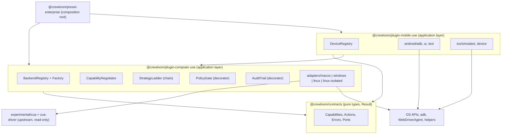

# Universal Computer Use: system design

Authoritative design for desktop (macOS, Windows, Linux) and mobile (Android, iOS) computer use in Crewloom. Work is split into packages in [WORK-PACKAGES.md](WORK-PACKAGES.md) and tracked in `ledger.json`. Read [README.md](README.md) first if you are an agent about to work.

Precedence: `CONSTITUTION.md` > root `AGENTS.md` > `agent/AGENTS.md` > this file. If this file contradicts the code you read, the code wins: record the discrepancy with `checkpoint` and fix this file in the same change.

## 1. Goal, scope, non-goals

**Goal.** An agent operates applications on a person's computer or phone without taking the person's focus or hardware pointer, using the least invasive method the platform allows, and always telling the truth about what worked.

**In scope.** Capability discovery, policy and consent, an auditable action pipeline, backends for macOS, Windows, Linux, Android, iOS, conformance tests that prove the invariants in section 3, bilingual (Arabic and English) user-facing messages.

**Non-goals.**
- No bypass of OS security (secure windows, UIPI, app-store restrictions, device lock).
- No new native helper where an existing one passes conformance (ADR-001).
- No edits to upstream packages under `agent/packages/experimental/*` or any non-`crewloom` upstream package.
- No native desktop code in `core/` (the Python `computer_use.py` stays a browser engine, ADR-005).
- No ordering of purchases, payments, or credential entry by the agent.

## 2. Verified facts and open claims

Everything below marked **Verified** was read in this repository on 2026-10-25. Everything marked **Unverified** comes from general knowledge of the operating systems and must be confirmed by the work package named in the last column before any code depends on it.

| # | Claim | Status | Confirmed by |
|---|---|---|---|
| F1 | `core/scripts/computer_use.py` is a browser engine (Chrome bridge, in-memory cursor); it has no native desktop code | Verified | - |
| F2 | `agent/packages/experimental/cua` owns the JSONL protocol (`src/protocol.ts`), `CuaBackend { helperPath, createChannel, guidance, description }`, `installCua`, `getCapabilities` | Verified | - |
| F3 | `experimental/cua-macos` targets `.macOS(.v14)`, uses ScreenCaptureKit, AX, SkyLight via `dlopen` with a public PID fallback; upstream README says Windows is "in development" | Verified | - |
| F4 | `@trycua/cua-driver` 0.28.0 declares native optional packages for darwin (arm64, x64), linux (arm64-gnu, x64-gnu) and win32 (arm64-msvc, x64-msvc); the existing plugin `experimental/computer-use-cua-driver-native` embeds it | Verified (package manifest only) | WP-03, WP-04, WP-05 test whether it behaves correctly |
| F5 | All of `agent/packages/experimental/*` is upstream and must not be edited; Crewloom code lives in `agent/packages/crewloom/*` | Verified (`agent/AGENTS.md`) | - |
| F6 | `@crewloom/contracts` exports `Result<T,E>` as `{ success: true, data } \| { success: false, error }` | Verified | - |
| F7 | Tests use vitest (`pnpm exec vitest run <path>`); typecheck is `pnpm run typecheck`; lint is `pnpm run lint` in `agent/` | Verified (root `package.json`) | WP-00 confirms the include pattern for new packages |
| F8 | `core/`, `agent/`, `bridge/`, `website/` are separate git repositories; the workspace root and `cli/` are not | Verified | - |
| U1 | Cua Driver on Windows and Linux satisfies invariants I1 to I4 | Unverified | WP-04, WP-05 |
| U2 | `Windows.Graphics.Capture` window capture needs Windows 10 build 18362 (1903) or later | Unverified | WP-04 |
| U3 | Wayland compositors do not allow injecting input into another client's window except through xdg-desktop-portal with user consent; GNOME does not implement `zwlr_layer_shell_v1` | Unverified | WP-05 |
| U4 | Chromium and Electron expose their accessibility tree only after an assistive-technology client is detected or a flag is set | Unverified | WP-03, WP-04, WP-05 |
| U5 | `adb` can create and use a secondary virtual display on Android 10 and later for a launched app | Unverified | WP-35 |
| U6 | WebDriverAgent exposes an HTTP API usable without Appium, on simulator and device | Unverified | WP-40, WP-41 |
| U7 | iPhone Mirroring on macOS 15 can be driven as a desktop window | Unverified | WP-42 |
| U8 | macOS may re-prompt for Screen Recording permission periodically on recent releases | Unverified | WP-03 |

## 3. Invariants (what every backend must prove)

| ID | Invariant | Measured by |
|---|---|---|
| I1 | An action does not change which window or app is frontmost, unless the action is the explicit `activate`/`launchApp` | `FocusProbe` before and after |
| I2 | An action does not move or click the user's hardware pointer unless the strategy is `hardware-input` and the user opted in for that session | `PointerProbe` before and after |
| I3 | The agent overlay never swallows the user's clicks (click-through) | `ClickThroughProbe` |
| I4 | `getCapabilities` is truthful: every `supported` feature works, every `unsupported` feature returns a typed error, never a silent no-op | capability-vs-behavior test |
| I5 | Cancellation and the kill switch stop work within a deadline and release held keys and buttons | `CancellationProbe` |
| I6 | Secrets and personal content are not persisted beyond policy (screenshots only in the attachment store; audit log redacts typed text) | audit redaction test |
| I7 | A refused action returns a typed `ComputerUseError`; no `throw` crosses a port boundary for expected failures | contract tests |
| I8 | Every user-facing message exists in Arabic and English | locale completeness test |

## 4. Architecture

Hexagonal (ports and adapters). Dependencies point inward only.



Rules:
1. `contracts` imports nothing. The plugin imports `contracts` and upstream type packages only. Adapters import their own native libraries and never each other.
2. The mobile plugin may import the plugin's `policy` and `audit` modules (they are generic over the subject kind) but never its desktop adapters.
3. Only the preset (composition root) wires decorators and picks adapters. No `if (platform === ...)` outside the registry and the preset.
4. Upstream `cua` is consumed through its public exports. Never copy its code; never edit it.

### Decorator pipeline (composition root)

```
Agent tool call
  -> PolicyGate        (allowlist, denylist, destructive-confirm, kill switch)
  -> AuditTrail        (start/finish events, redaction)
  -> StrategyLadder    (accessibility -> targeted-input -> hardware-input (opt-in) -> isolated-session)
  -> Backend adapter   (macOS | Windows | Linux | Android | iOS)
```

Each stage implements the same `ComputerBackend` (or `DeviceBackend`) port, so stages stack without knowing each other.

## 5. Domain model and contracts

The contracts are TypeScript in `agent/packages/crewloom/contracts/src/computer-use.ts` and `mobile-use.ts`, re-exported from `index.ts`. WP-01 implements this section exactly. Do not rename members; extend by adding.

```ts
import { Result } from './index.ts' // use the repo's actual relative import style (WP-00 records it)

export type Platform = 'macos' | 'windows' | 'linux' | 'android' | 'ios'
export type SessionKind = 'aqua' | 'win32' | 'x11' | 'wayland' | 'android' | 'ios-simulator' | 'ios-device'
export type Strategy = 'accessibility' | 'targeted-input' | 'hardware-input' | 'isolated-session'
export type Support = 'supported' | 'degraded' | 'unsupported'

export type FeatureId =
  | 'axTree' | 'axAction' | 'setValue'
  | 'backgroundClick' | 'backgroundType' | 'backgroundScroll'
  | 'windowCapture' | 'virtualCursor' | 'isolatedSession'
  | 'gestures' | 'systemKeys' | 'rotation'

export type Permission =
  | 'accessibility' | 'screen-recording' | 'portal-consent' | 'same-integrity-level'
  | 'usb-debugging' | 'accessibility-service' | 'developer-mode' | 'device-trust'

export interface FeatureStatus {
  readonly support: Support
  readonly strategies: readonly Strategy[]       // ladder rungs that can serve this feature, best first
  readonly reason?: string                       // required when support !== 'supported'
  readonly requires?: readonly Permission[]
}

export interface PlatformCapabilities {
  readonly platform: Platform
  readonly osVersion: string
  readonly arch: string
  readonly session: SessionKind
  readonly features: Readonly<Partial<Record<FeatureId, FeatureStatus>>>
}

export type ComputerUseErrorCode =
  | 'UNSUPPORTED_ON_PLATFORM' | 'PERMISSION_REQUIRED' | 'TARGET_ELEVATED'
  | 'ACCESSIBILITY_UNAVAILABLE' | 'SECURE_SURFACE'
  | 'DEVICE_UNAUTHORIZED' | 'DEVICE_NOT_FOUND'
  | 'POLICY_DENIED' | 'CONFIRMATION_REQUIRED' | 'KILL_SWITCH_ENGAGED'
  | 'TIMEOUT' | 'CANCELLED' | 'BACKEND_FAILURE'

export interface ComputerUseError {
  readonly code: ComputerUseErrorCode
  readonly message: string                       // English diagnostic for logs; user text comes from locale tables
  readonly requires?: readonly Permission[]
  readonly cause?: unknown
}

export interface ActionOutcome {
  readonly dispatched: true
  readonly verified: false                       // success is established by reading fresh state, never by the dispatcher
  readonly strategy: Strategy
  readonly focusChanged: boolean
  readonly usedHardwareCursor: boolean
  readonly elapsedMs: number
}

export interface PolicySubject {
  readonly kind: 'desktop-app' | 'mobile-app' | 'device'
  readonly id: string                            // bundle id, package name, executable identity, or device id
}

export interface ExecutionContext {
  readonly signal: AbortSignal
  readonly subject: PolicySubject
  readonly sessionId: string
  readonly allowHardwareInput: boolean           // false unless the person opted in for this session
}

export type BackendResult<T> = Result<T, ComputerUseError>

export interface ComputerBackend<Action> {
  readonly id: string
  probe(signal: AbortSignal): Promise<BackendResult<PlatformCapabilities>>
  execute(action: Action, context: ExecutionContext): Promise<BackendResult<ActionOutcome>>
  dispose(): Promise<void>
}
```

Desktop actions (`DesktopAction`) are a discriminated union on `kind`: `click`, `type`, `pressKey`, `scroll`, `drag`, `hover`, `setValue`, `screenshot`, `getState`, `activate`, `launchApp`. Mobile actions (`MobileAction`) are `tap`, `longPress`, `swipe`, `pinch`, `typeText`, `pasteText`, `systemKey` (`back | home | recents | volumeUp | volumeDown | power`), `rotate`, `screenshot`, `getState`, `launchApp`, `listDevices`. Every union member carries only serialisable data (command pattern) so it can be audited, replayed in tests, and cancelled. Exhaustive `switch` with `assertNever` is required wherever the unions are consumed.

## 6. Patterns and where they live

| Pattern | Where | Why here |
|---|---|---|
| Ports and adapters | contracts ports, `adapters/*`, `android/*`, `ios/*` | Native details never leak inward |
| Anti-corruption layer | each adapter maps Cua Driver, adb, WebDriverAgent wire formats to contracts | Upstream tool schemas change without a stability promise (F4) |
| Registry and factory | `BackendRegistry` | One place decides which backend serves a platform; no scattered `if (os)` |
| Strategy plus chain of responsibility | `StrategyLadder` | Try the least invasive rung first, degrade explicitly, report the rung used |
| Decorator | `PolicyGate`, `AuditTrail`, `TimeoutGuard` | Cross-cutting concerns without touching adapters |
| Command | `DesktopAction`, `MobileAction` unions | Serialisable, auditable, testable, cancellable |
| Null object | `UnsupportedBackend` returned when an adapter is absent | Typed refusal instead of a crash or a silent no-op |
| State machine | device session: `discovered -> authorized -> connected -> busy -> closed` | Illegal transitions are unrepresentable; kill switch is a transition |
| Observer | `AuditTrail` events consumed by UI and logs | Overlay and logs without coupling |
| Result type | every port | Expected failures are values (I7) |

Anti-patterns to reject in review: `utils.ts` or `helpers.ts`; a god `ComputerUseManager`; boolean-flag parameters that switch behavior; platform checks in business logic; catch-and-ignore; hidden global state; speculative configuration.

## 7. Desktop backends

Policy of support: feature detection at runtime, never OS version sniffing, except where no probe exists (record such a place in code with the reason). Tiers: **A** supported and tested, **B** supported with documented degradation, **C** refused with a typed error.

| Platform | Primary route | Fallback rungs | Tier targets (to be confirmed by spikes) |
|---|---|---|---|
| macOS | Existing `cua-macos` or Cua Driver darwin (WP-03 decides) | PID-directed events, public API when SkyLight symbols are missing | 14 and later: A. Older: C |
| Windows | UI Automation patterns via Cua Driver win32 if it passes (ADR-001), else Crewloom helper (WP-22) | Directed window messages for classic Win32 only | 10 22H2 and 11: A. Before build 18362: C |
| Linux X11 | AT-SPI first | Isolated X display for apps the agent launches; XTEST only there | Mainstream distributions: A |
| Linux Wayland | AT-SPI plus portal with consent | Isolated nested compositor for launched apps | KDE and wlroots: B. GNOME: B with no overlay |

Per-platform facts that shape the design (all subject to section 2):
- Windows: another process at a higher integrity level cannot be driven (`TARGET_ELEVATED`); high-DPI requires per-monitor DPI awareness in any helper; the overlay is a layered, transparent, no-activate, topmost tool window; exclusive-fullscreen apps hide it.
- Linux: synthetic X events are ignored by many toolkits, so they are not a primary route; the overlay on X11 is an ARGB window with an empty input shape; on GNOME Wayland no overlay is possible, so the UI shows the pointer inside the Crewloom window instead and `virtualCursor` is `unsupported`.
- macOS: the private SkyLight route may disappear in any release; the public PID route is the degraded fallback; capture uses ScreenCaptureKit.

## 8. Mobile design

Mobile targets a device, not a window. It gets its own plugin and tool family (`mobile.*`) and its own `DeviceBackend` port instance of `ComputerBackend<MobileAction>`. Do not push mobile into the upstream `cua` protocol.

**Android** (any host OS through `adb`)
- Transport: a wrapper around the `adb` executable returning `Result`, with discovery, authorization state, per-call timeout, and process-group cleanup.
- State: UI hierarchy dump parsed into a typed tree; actions by node when possible (resource id, text, bounds), by coordinates otherwise.
- Gestures: `input tap|swipe|keyevent`; text: a Crewloom input method or clipboard paste for Arabic and symbols (`adb shell input text` is unreliable for non-ASCII; confirm in WP-33).
- Capture: `screencap`; secure windows return black, reported as `SECURE_SURFACE`, never bypassed.
- Isolation candidate: virtual display (U5), investigated in WP-35.
- Minimum API proposed: 24; best experience: 30 and later. Confirm in WP-31 and WP-32.

**iOS**
- Simulator (macOS host only): `xcrun simctl` for lifecycle and capture; WebDriverAgent over HTTP for UI tree and gestures (U6).
- Device (macOS host only): WebDriverAgent on a developer-signed install; connection method depends on the iOS version (WP-41 records exactly which).
- No background mode exists on iOS: the target app is foreground on the device. State this in capabilities as `isolatedSession: unsupported`.

**Both**: no pointer exists, so `virtualCursor` is replaced by an annotation drawn on screenshots in Crewloom's own UI.

## 9. Policy, privacy, security

- **Consent first.** No observation or input before the person has granted the subject (application or device). Grants are identified by verified identity (executable path and signature, package and signing certificate, device id), not by display name. The upstream `cua` application grants are reused for desktop.
- **Allow and deny.** Default deny for mobile applications in these classes: banking and payments, password managers, authenticators and OTP, device security settings. Default confirm for destructive verbs: delete, send, purchase, pay, uninstall, factory reset, change password.
- **Kill switch.** One global action cancels all in-flight work (I5), releases held inputs, and moves sessions to `closed`.
- **Hardware input** is off by default and enabled per session with explicit person consent; every outcome says `usedHardwareCursor`.
- **Data.** Screenshots go to the existing attachment store only. The audit log stores action kind, subject id, strategy, outcome, and timings; typed text and screenshot bytes are never logged. Notifications and messages on a phone are treated as sensitive content.
- **Threat model** (finished in WP-52): prompt injection through on-screen text, confused deputy through a granted app, privilege escalation through an elevated target, overlay spoofing, helper binary tampering, ADB over network exposure, supply chain via native packages (pin exact versions).

## 10. Failure model

- Every call has a deadline and an `AbortSignal`. Defaults live in validated config, not as literals in code.
- A cancelled call may have already delivered input: results say so (`CANCELLED` with `partial: true` in the message), and callers re-read state before retrying.
- Native helpers run as child processes under a watchdog. Crash: the backend reports `BACKEND_FAILURE`, state resets to `discovered`, and the next call may restart the helper once; a second crash within the window opens a breaker for that backend until the person re-enables it.
- No fallback silently changes the invasiveness of an action. Moving down the ladder is allowed; moving to `hardware-input` is only allowed with `allowHardwareInput`.

## 11. Observability

`AuditTrail` emits typed events: `action.started`, `action.finished`, `action.refused`, `capability.probed`, `session.killed`. Each carries `sessionId`, `subject`, `strategy`, `elapsedMs`, `errorCode?`. The desktop UI subscribes for the overlay and a visible activity list. Counters per error code feed the conformance report.

## 12. Compatibility and versioning

- Capability negotiation is the compatibility mechanism: a backend reports what it can do on this machine now.
- New fields on contracts are added as optional; removals require an adapter and a documented removal condition (Zero-destruction).
- Supported OS tiers are published in `agent/packages/crewloom/computer-use/README.md` and generated from the conformance results, not typed by hand.
- Upstream dependency versions (`@trycua/cua-driver`) are pinned exactly; a bump is its own change with a conformance run attached.

## 13. Test strategy

| Level | What | Where | Runs |
|---|---|---|---|
| Unit | pure logic: policy decisions, ladder selection, locale completeness, parsers | package `tests/*.spec.ts` (vitest) | every change |
| Contract | each backend against `ComputerBackend` behavior with a fake native layer | `computer-use-conformance` | every change |
| Conformance (live) | invariants I1 to I5 against real apps | `computer-use-conformance` probes | per OS, on a graphical session |
| End to end | an agent task through the full pipeline on a fixture app | per adapter | per OS, per release |

Fixture applications per OS: a native text editor, Chrome, an Electron app, a Qt or GTK app (Linux), a Win32 and a WPF app (Windows). Results are recorded as a matrix in `core/Brain/computer-use-program/CONFORMANCE.md` (created by WP-02, updated by later WPs). A cell that was not run is written `not run` and is never inferred.

## 14. Team model and review gates

One agent can wear each hat in turn; a stronger or second agent should take the reviewer hat when available. The hat is named in each work package.

| Hat | Responsibility |
|---|---|
| Staff architect | contracts, ADRs, dependency direction, patterns |
| Platform lead (macOS, Windows, Linux, Android, iOS) | adapter correctness and OS facts |
| Security engineer | policy, threat model, deny lists, supply chain |
| SDET | probes, fixtures, matrix, flake control |
| SRE and release | CI, release protocol, rollback |
| Technical writer and i18n | READMEs, Arabic and English strings, RTL |

**Definition of ready (before claiming).** Dependencies are `done`; `owns` paths do not overlap a live claim; baseline in `BASELINE.md` exists; you can state the acceptance check.

**Definition of done (before `done`).** All gates in the work package ran and their real output is in `--evidence`; no new `any`, `as unknown as`, `@ts-ignore`, `!important`, empty `catch`, or `--no-verify`; files end with one newline; new user-facing strings exist in Arabic and English; a test fails without the change; README or JSDoc updated for the touched module; `core/Brain` records updated when a reusable challenge or fix appeared.

**Reviewer checklist (apply before marking done).** Single responsibility per module and function under about 60 lines; imports follow section 4; errors are typed values; no duplicated type or catalog; names say what modules own; no dead code; no speculative option; comments explain intent only.

## 15. Architecture decision records

| ADR | Decision | Status |
|---|---|---|
| 001 | Adopt Cua Driver per OS where it passes conformance; build Crewloom helpers only for gaps (WP-22, WP-24 are dormant until a spike fails) | Proposed; finalised by WP-06 |
| 002 | Compatibility by runtime capability negotiation, not by OS version tables in code | Accepted |
| 003 | Strategy ladder with hardware input opt-in per session | Accepted |
| 004 | Mobile is a separate plugin and tool family built on a device port; it reuses policy and audit | Accepted |
| 005 | `core/scripts/computer_use.py` stays browser-only; no native desktop logic in `core/` | Accepted |
| 006 | Programme state lives in `ledger.json`, mutated only through `core/scripts/program_ledger.py` | Accepted |
| 007 | Native helper language, if any helper is needed (WP-22, WP-24): Rust, matching the upstream driver; decided with the spike evidence | Proposed |

## 16. Open questions (resolve in the named package, then delete the line)

- Does Cua Driver satisfy I1 to I4 on Windows and Linux? WP-04, WP-05.
- Android Arabic text input route (input method versus clipboard). WP-33.
- Which iOS device connection tooling works on the iOS versions in use. WP-41.
